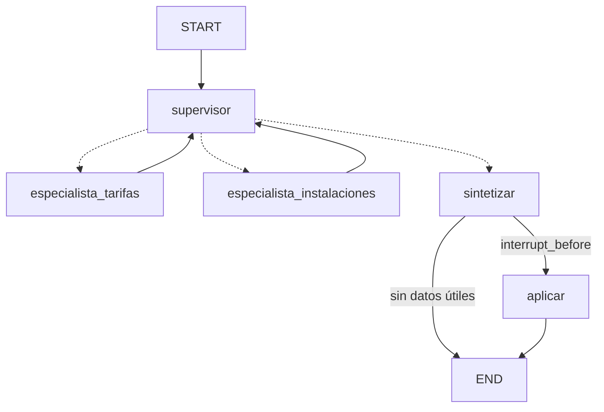

# Agente Deporte municipal de Madrid — Project Break 2

> En construcción.

Agente multiagente con **LangGraph** que amplía el RAG del Project Break 1
(instalaciones, tarifas y normas del deporte municipal de Madrid).

Equipo 06 — María Muriel · Davide Campi · Alejandro Dietta

## Instalación

```bash
python3.12 -m venv .venv
source .venv/bin/activate          # Windows: .venv\Scripts\activate
python -m pip install -r requirements.txt
cp .env.example .env               # y pon tu GOOGLE_API_KEY
```

## RAG del PB1

El RAG del PB1 vive en `rag/` como paquete (importado con `scripts/importar_pb1.py`).
Construir el índice una vez (la primera vez descarga el modelo de embeddings, ~470 MB):

```bash
python -m rag --index
python -m rag --ask "¿Cuánto cuesta el abono de piscina?"
```

## Agente por terminal (CLI)

```bash
python main.py                         # chat: escribe tu pregunta y luego 'aprobar' o 'rechazar'
python main.py --demo                  # guion: un rechazo y una aprobación en el mismo thread_id
python main.py --demo --auto-aprobar   # el mismo guion aprobando todo
```

Comandos del modo interactivo: `aprobar`, `rechazar`, `nueva` (conversación nueva = `thread_id` nuevo) y `salir`.

Cada turno muestra el log del grafo (`supervisor → especialista_tarifas (llm, iter 1)`),
la traza de tools (`tool`, `status`, `preview`), la respuesta, el plan propuesto y
`pendiente_hitl` / `done`.

### Probar el human-in-the-loop

1. Haz una pregunta → el grafo se detiene **antes de `aplicar`** y muestra el plan (`pendiente_hitl=True`).
2. Mientras haya un plan pendiente no se aceptan preguntas nuevas.
3. `aprobar` → se guarda el plan en `salidas/` y `done=True`.
   `rechazar` → no se aplica nada (`done=False`) y puedes seguir preguntando en el mismo `thread_id`.

### Cómo decide el grafo



- **El LLM propone, Python decide.** El supervisor y los especialistas preguntan a Gemini, pero si la
  respuesta no es válida o Gemini falla, se aplica un fallback en Python y el log indica el motivo.
- Cada especialista solo puede usar sus tools (`permitidas`); cualquier otra sale `blocked` en la traza.
- Si ninguna tool devuelve datos, se responde directamente, sin plan ni HITL.

| Límite | Valor | Lo aplica |
|---|---|---|
| `MAX_ITER` | 6 vueltas del supervisor por turno | `src/graph.py` |
| `MAX_STEPS` | 3 tools por especialista | `src/graph.py` |
| `MAX_TURNS` | 10 turnos por `thread_id` | `src/agent.py` |

Detalle completo en [`specs/grafo.md`](specs/grafo.md).

### Sin clave ni red (mocks)

Con `USE_MOCKS=1` en el `.env`, el grafo usa tools falsas (`src/mocks/tools_fake.py`) y no necesita
el índice del RAG ni red. Sin `GOOGLE_API_KEY`, el grafo funciona igual con los fallbacks en Python.

```bash
python -m pytest -q   # tests del grafo y de las tools: sin red ni clave
```

## Estructura

```
├── main.py / app.py      # CLI y Streamlit
├── config.py             # límites, modelo y rutas
├── src/                  # estado, grafo, agente, LLM
│   └── tools/            # allowlist + tools
├── rag/                  # RAG del PB1 como paquete
├── data/                 # fallback de la API
├── assets/               # imagen para la tool multimodal
├── specs/                # especificación (SDD)
├── scripts/              # utilidades
├── tests/
└── entregables/          # informe de decisiones
```
