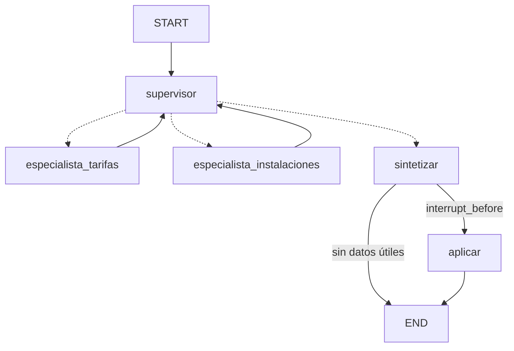

# Agente Deporte municipal de Madrid — Project Break 2

> En construcción.

Agente multiagente con **LangGraph** que amplía el RAG del Project Break 1
(instalaciones, tarifas y normas del deporte municipal de Madrid).

Equipo 04 — María Muriel · Davide Campi · Alejandro Dietta

## Instalación

```bash
python3.12 -m venv .venv
source .venv/bin/activate          # Windows: .venv\Scripts\activate
python -m pip install -r requirements.txt
cp .env.example .env               # y pon tu GOOGLE_API_KEY
```

## RAG del PB1

El RAG del PB1 vive en `rag/` como paquete (importado con `scripts/importar_pb1.py`).
Construir el índice una vez (la primera vez descarga el modelo de embeddings, ~470 MB):

```bash
python -m rag --index
python -m rag --ask "¿Cuánto cuesta el abono de piscina?"
```
Resultado del indexado: **1714 chunks** en la colección `deporte_municipal` (~1 minuto, embeddings
locales de 384 dimensiones). `rag/chroma/` y `rag/output/` no se suben a Git: hay que indexar en local.
Si cambia el modelo de embeddings, el chunking o el corpus, hay que volver a indexar.


## Tools y allowlist


El agente tiene cuatro tools (`src/tools/`). Ninguna se ejecuta directamente: todas pasan por
`ejecutar_tool`, la única puerta de ejecución.


| Tool | Qué hace | La usa |
|---|---|---|
| `rag_ask` | Envuelve `rag.responder()` del PB1: tarifas, descuentos, instalaciones y normas | `especialista_tarifas` |
| `api_deporte` | Agenda de actividades deportivas del Ayuntamiento (ver abajo) | `especialista_instalaciones` |
| `hora_actual` | Día y hora actuales en Madrid (determinista, sin red) | ambos |
| `describir_imagen` | Imagen → texto con Gemini (ver sección de la tool multimodal) | `especialista_instalaciones` |


- Cada tool devuelve un dict `{"status", "texto", ...}`; el `texto` es lo que lee el LLM.
  `status`: `ok` | `abstencion` | `error`.
- `ejecutar_tool(nombre, args, permitidas=None)` devuelve la entrada de traza
  `{tool, args, status, preview, resultado}` (`preview` ≤ 200 caracteres). Si el nombre no está en
  `TOOLS_PERMITIDAS`, o no está en `permitidas` (las tools del especialista), **no se ejecuta nada** y el
  status es `blocked`. Nunca lanza excepciones: un fallo de la tool queda como `error`.
- `rag_ask` necesita el índice construido y `GOOGLE_API_KEY`. Si el RAG se abstiene devuelve `abstencion`
  y sin fuentes. El RAG se importa de forma diferida: el modelo de embeddings solo se carga en la primera consulta.


Probar las tools fuera del grafo:


```bash
python -m pytest -q    # tests de las tools: sin red ni clave
python -c "from src.tools import ejecutar_tool; print(ejecutar_tool('hora_actual'))"
python -c "from src.tools import ejecutar_tool; print(ejecutar_tool('rag_ask', {'consulta': 'cuanto cuesta la entrada a la piscina de verano para adultos'}))"
python -c "from src.tools import ejecutar_tool; print(ejecutar_tool('borrar_todo'))"   # status blocked
```


### API externa: `api_deporte`


- **Fuente:** [Agenda de actividades deportivas](https://datos.madrid.es/dataset/212504-0-agenda-actividades-deportes)
  del Ayuntamiento de Madrid (formato JSON-LD; las actividades están en `@graph`). Descargada el 20/10/2026.
- **Qué hace:** pide la agenda con timeout de 12 s, descarta lo ya terminado, filtra por las palabras de la
  consulta (y por «gratis») y devuelve un resumen corto (5 líneas por defecto, máximo 10) con lugar, días,
  hora y precio. Nunca devuelve el JSON entero.
- **Fallback:** si falla la red, la respuesta o el formato, lee `data/fallback_api.json` (copia del 20/10/2026)
  y lo indica en el texto: `Fuente: api (datos.madrid.es)` o `Fuente: local (copia del 20/10/2026)`.
- **Estados:** `ok`, `abstencion` (no hay actividades vigentes que encajen) y `error` (ni API ni respaldo).


## Fuentes del corpus


Descargadas de datos.madrid.es y madrid.es durante el PB1 y añadidas al repositorio del PB1 a partir del
**13/09/2026**. Importadas a este
repositorio el 15/10/2026. Datos públicos del Ayuntamiento de Madrid.


| Fichero (`rag/data/`) | Fuente |
|---|---|
| `200186-0-polideportivos-csv.csv` | https://datos.madrid.es/dataset/200186-0-polideportivos |
| `200215-0-instalaciones-deportivas-csv.csv` | https://datos.madrid.es/dataset/200215-0-instalaciones-deportivas |
| `210227-0-piscinas-publicas-csv.csv` | https://datos.madrid.es/dataset/210227-0-piscinas-publicas |
| `300083-10-deportes-tarifas.xlsx` | https://datos.madrid.es/dataset/300083-0-deportes-tarifas |
| `300097-3-deportes-descuentos-csv.csv` | https://datos.madrid.es/dataset/300097-0-deportes-descuentos |
| `PreciosPublicos2026.pdf` | https://www.madrid.es/UnidadesDescentralizadas/Deportes/Colecciones/ficheros/TarifasD/PreciosPublic… |
| `Tarifas_deportivas.pdf` | https://www.madrid.es/UnidadesDescentralizadas/Deportes/Colecciones/ficheros/TarifasD/Tarifas_depor… |
| `20250912_InfografíaCómoAdquirirOrenovarUnADM.pdf` | https://www.madrid.es/UnidadesDescentralizadas/Deportes/Faq/ficheros/infografias%20faq%202025/20250… |
| `eli-es-md-01860896-reg-2012-10-15-(1)-dof-spa.pdf` | <https://sede.madrid.es/eli/es-md-01860896/reg/2012/10/15/(1)/dof/spa/pdf> |

## Agente por terminal (CLI)

```bash
python main.py                         # chat: escribe tu pregunta y luego 'aprobar' o 'rechazar'
python main.py --demo                  # guion: un rechazo y una aprobación en el mismo thread_id
python main.py --demo --auto-aprobar   # el mismo guion aprobando todo
```

Comandos del modo interactivo: `aprobar`, `rechazar`, `nueva` (conversación nueva = `thread_id` nuevo) y `salir`.

Cada turno muestra el log del grafo (`supervisor → especialista_tarifas (llm, iter 1)`),
la traza de tools (`tool`, `status`, `preview`), la respuesta, el plan propuesto y
`pendiente_hitl` / `done`.

### Probar el human-in-the-loop

1. Haz una pregunta → el grafo se detiene **antes de `aplicar`** y muestra el plan (`pendiente_hitl=True`).
2. Mientras haya un plan pendiente no se aceptan preguntas nuevas.
3. `aprobar` → se guarda el plan en `salidas/` y `done=True`.
   `rechazar` → no se aplica nada (`done=False`) y puedes seguir preguntando en el mismo `thread_id`.

### Cómo decide el grafo



- **El LLM propone, Python decide.** El supervisor y los especialistas preguntan a Gemini, pero si la
  respuesta no es válida o Gemini falla, se aplica un fallback en Python y el log indica el motivo.
- Cada especialista solo puede usar sus tools (`permitidas`); cualquier otra sale `blocked` en la traza.
- Si ninguna tool devuelve datos, se responde directamente, sin plan ni HITL.

| Límite | Valor | Lo aplica |
|---|---|---|
| `MAX_ITER` | 6 vueltas del supervisor por turno | `src/graph.py` |
| `MAX_STEPS` | 3 tools por especialista | `src/graph.py` |
| `MAX_TURNS` | 10 turnos por `thread_id` | `src/agent.py` |

Detalle completo en [`specs/grafo.md`](specs/grafo.md).

### Sin clave ni red (mocks)

Con `USE_MOCKS=1` en el `.env`, el grafo usa tools falsas (`src/mocks/tools_fake.py`) y no necesita
el índice del RAG ni red. Sin `GOOGLE_API_KEY`, el grafo funciona igual con los fallbacks en Python.

```bash
python -m pytest -q   # tests del grafo y de las tools: sin red ni clave
```

## Agente en el navegador (Streamlit)

```bash
streamlit run app.py                   # abre http://localhost:8501
USE_MOCKS=1 streamlit run app.py       # tools falsas: sin índice del RAG ni red
```

`app.py` es solo cliente de `src/agent.py` (mismas funciones que la CLI: `procesar_turno` y `aprobar_plan`):

- **Chat:** cada mensaje es un turno del grafo en el mismo `thread_id` (se ve en la barra lateral).
- **Barra lateral:** el `thread_id`, los límites del agente (`MAX_ITER`, `MAX_STEPS`, `MAX_TURNS`, solo informativos:
  los aplica Python) y, cuando hay un plan pendiente, el plan y los botones **Aprobar** / **Rechazar**.
- **Nueva conversación:** vacía el chat y empieza con un `thread_id` nuevo (sin memoria de la anterior).
- **Estado / log / tools (debug):** expander al final de la página con lo que hizo el agente en el último turno.

### Probar el human-in-the-loop en la web

1. Pregunta, p. ej. «¿Cuánto cuesta la entrada a la piscina de verano para adultos?» → la respuesta sale con
   **Plan (pendiente de aprobación)** y el chat se bloquea hasta que decidas.
2. **Rechazar** → «Plan rechazado…», no se aplica nada y puedes seguir preguntando en la misma conversación.
3. Otra pregunta → **Aprobar** → «✅ Plan aprobado y guardado en salidas/…» (`done=True`).

### Panel de debug

El expander **Estado / log / tools (debug)** muestra el último turno:

- **Estado:** `thread_id`, `pendiente_hitl`, `done`, `error`, el plan y el `log` del grafo
  (`supervisor → especialista_tarifas (llm, iter 1)`, `pausa HITL antes de aplicar`, `aplicar → aprobado`…).
- **Traza de tools:** una tabla con una fila por llamada (`tool`, `status`, `preview`). El `status` dice si la tool
  dio datos (`ok`), se abstuvo (`abstencion`), falló (`error`) o la bloqueó la allowlist (`blocked`).

```bash
python -m pytest tests/test_app.py -v   # HITL y panel de debug (AppTest, sin red ni clave)
```

## Tool multimodal (`describir_imagen`)

Imagen → texto con Gemini (`src/tools/describir_imagen.py`). Envía los bytes de la imagen y un prompt
(más la pregunta del usuario, si la hay) y devuelve `{"status": "ok" | "error", "texto": ...}`; nunca lanza excepciones.

- **Imagen demo:** `assets/imagen_demo.jpg`, la infografía «Cómo adquirir online un Abono Deporte Madrid». Sin ruta, la tool usa esta imagen.
- **En el grafo:** la usa `especialista_instalaciones` cuando la pregunta menciona imagen, foto, cartel o infografía.
- **Requiere** `GOOGLE_API_KEY` en `.env` (mismo modelo que el grafo, `LLM_MODEL`).

Probarla aislada:

```bash
python -c "from src.tools.describir_imagen import describir_imagen; print(describir_imagen(pregunta='¿Qué pasos hay que seguir?'))"
python -m pytest tests/test_describir_imagen.py -v   # sin red ni clave (Gemini simulado)
```

## Estructura

```
├── main.py / app.py      # CLI y Streamlit
├── config.py             # límites, modelo y rutas
├── src/                  # estado, grafo, agente, LLM
│   └── tools/            # allowlist + tools
├── rag/                  # RAG del PB1 como paquete
├── data/                 # fallback de la API
├── assets/               # imagen para la tool multimodal
├── specs/                # especificación (SDD)
├── scripts/              # utilidades
├── tests/
└── entregables/          # informe de decisiones
```
