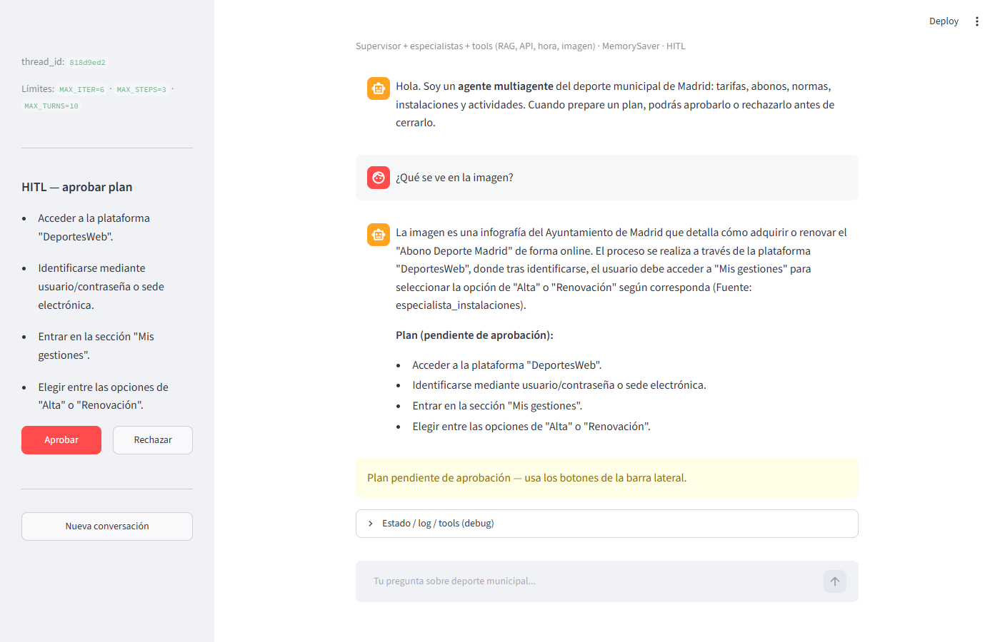
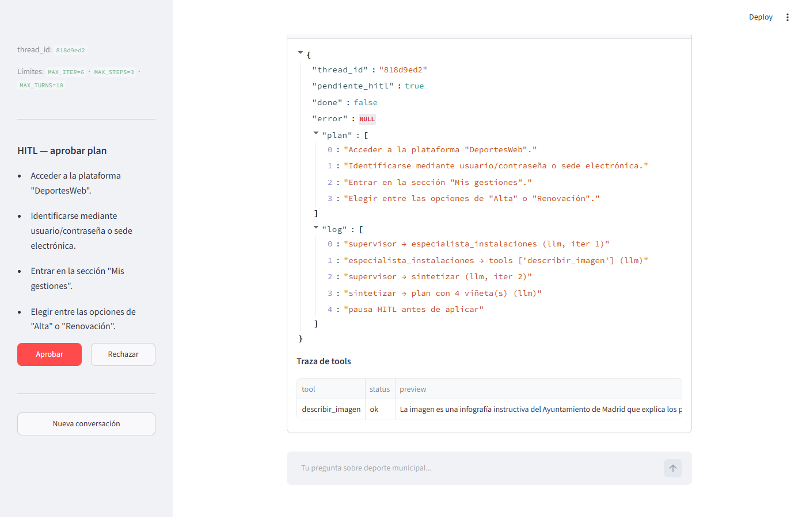
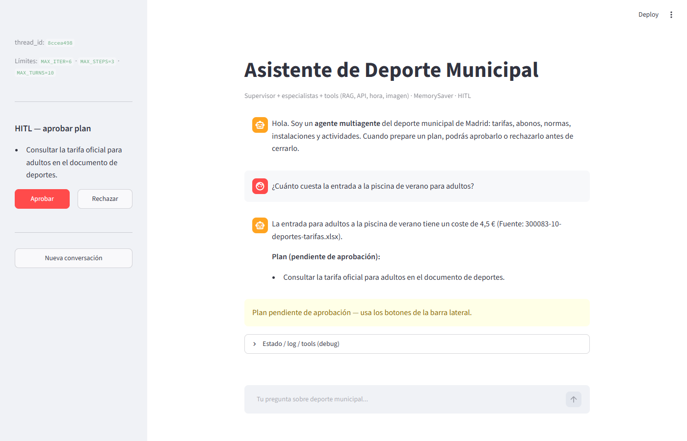
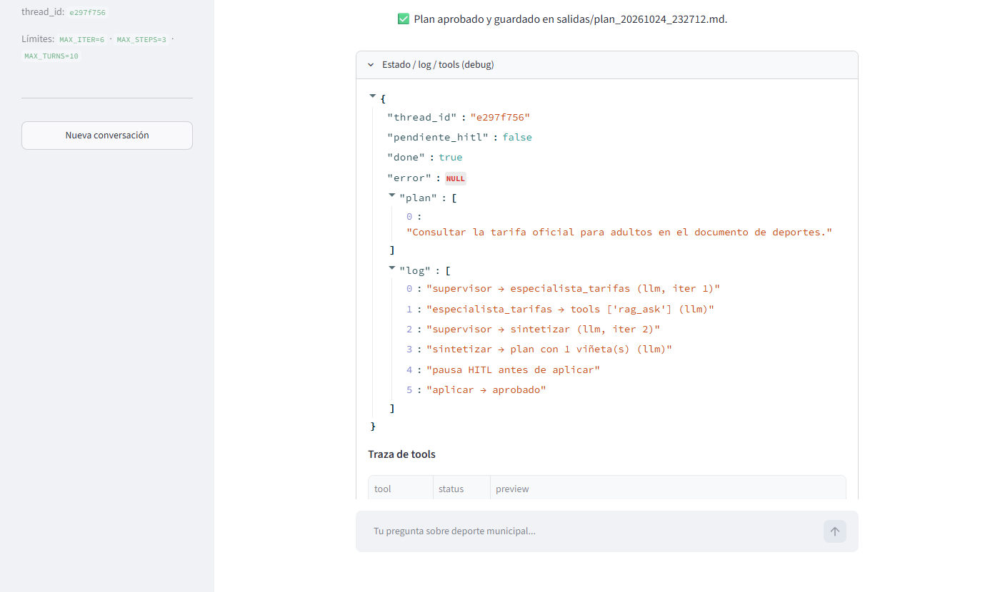

# Informe de decisiones — Project Break 2

Agente multiagente con LangGraph sobre el deporte municipal de Madrid, a partir del RAG del PB1.

| Bloque | Responsable |
|---|---|
| Grafo + CLI | Davide |
| Tools + RAG | María |
| Interfaz + multimodal | Alex |

---

## 1. Diseño del grafo y especialistas (Davide)

**Nodos.** `supervisor` → `especialista_tarifas` / `especialista_instalaciones` → `sintetizar` → `aplicar`.
Los especialistas vuelven siempre al supervisor, que decide si hace falta otro o si ya se puede sintetizar.
Diagrama y reglas completas en `specs/grafo.md`.

**Por qué dos especialistas.** Separan dos tipos de información con fuentes y riesgos distintos:

| Especialista | Información | Tools permitidas |
|---|---|---|
| `especialista_tarifas` | Estable y oficial: tarifas, abonos, descuentos, normas, centros | `rag_ask`, `hora_actual` |
| `especialista_instalaciones` | Viva: agenda de actividades, imágenes adjuntas | `api_deporte`, `hora_actual`, `describir_imagen` |

**El LLM propone, Python decide.**
- El supervisor pregunta a Gemini el siguiente nodo; si la respuesta no está en la lista, o Gemini falla
  (sin clave, 503…), decide un fallback por palabras clave y el log indica el motivo.
- El especialista pregunta a Gemini *qué* tools usar, pero los argumentos los construye Python
  y se ejecutan con `ejecutar_tool(..., permitidas=...)`: una tool ajena o inventada queda `blocked`.
- Los límites (`MAX_ITER`, `MAX_STEPS`, `MAX_TURNS`) y `done` los decide siempre Python.

**Memoria.** `MemorySaver` + `thread_id`: los mensajes se acumulan por conversación y una pregunta corta
de seguimiento se completa con la anterior. "Nueva conversación" = `thread_id` nuevo.

**Sin datos, sin plan.** Si ninguna tool devuelve datos útiles (todo error o abstención), `sintetizar`
responde directamente y el grafo termina sin pedir aprobación: no tiene sentido aprobar un plan vacío.

## 2. Human-in-the-loop (Davide)

**Momento.** El grafo se compila con `interrupt_before=["aplicar"]`: se detiene después de redactar la
respuesta y el plan, y antes de cualquier efecto (guardar el plan en `salidas/`).
`aprobar_plan(thread_id, aprobado)` escribe la decisión con `update_state` y reanuda con `invoke(None)`.
Sin aprobación explícita, `aplicar` no tiene efecto.

**Ejecución real** (`python main.py --demo`, Gemini + RAG del PB1, 19/10/2026):

*Rechazo.* Pregunta: «¿Cuánto cuesta la entrada a la piscina de verano para adultos?»

```
supervisor → especialista_tarifas (llm, iter 1)
especialista_tarifas → tools ['rag_ask'] (llm)
supervisor → sintetizar (llm, iter 2)
sintetizar → plan con 3 viñetas (llm)
pausa HITL antes de aplicar
tool rag_ask   ok   La entrada para adultos cuesta 4,5 € (Fuente: 300083-10-deportes-tarifas.xlsx)
→ rechazar → aplicar → rechazado · pendiente_hitl=False · done=False
```

*Aprobación* (mismo `thread_id`). Pregunta: «¿Y qué actividades hay esta semana?»

```
supervisor → especialista_tarifas (fallback, iter 1)
especialista_tarifas → tools ['rag_ask', 'hora_actual'] (llm)
supervisor → especialista_instalaciones (llm, iter 2)
especialista_instalaciones → tools ['api_deporte', 'hora_actual'] (llm)
supervisor → sintetizar (llm, iter 3)
pausa HITL antes de aplicar
→ aprobar → aplicar → aprobado · plan guardado en salidas/ · done=True
```

En esa ejecución `api_deporte` aún no estaba en la allowlist y salió `blocked`, y el agente lo explicó en
la respuesta en vez de inventar actividades.

## 3. Tools y RAG (María)

**Formato común.** Cada tool devuelve un dict `{"status", "texto", ...}`. El `texto` es lo que lee el LLM y el
`status` (`ok`, `abstencion` o `error`) permite al grafo distinguir "no hay datos" de "ha fallado", algo que con
un texto suelto habría que deducir mirando el mensaje. `ejecutar_tool` es la única puerta de ejecución y devuelve
la entrada de traza `{tool, args, status, preview, resultado}`. Añade `blocked` cuando el nombre no está en
`TOOLS_PERMITIDAS` o no está en `permitidas` (las tools del especialista), y entonces no se ejecuta nada.
Nunca lanza excepciones.

**Cómo se enchufa el RAG.** `rag_ask` envuelve `rag.responder()` del PB1, que ya devolvía la respuesta, las fuentes
y la abstención sin lanzar excepciones. Si el RAG se abstiene, la tool devuelve `abstencion` y sin fuentes (para
que no se citen documentos que no respaldan la respuesta). El RAG se importa de forma diferida: el modelo de
embeddings (torch) solo se carga en la primera consulta, así los tests y el arranque no pagan ese coste.
Coste medido: entre 8 y 11 s por consulta, incluida la carga del modelo en la primera llamada, porque cada
`rag_ask` hace una recuperación local y una generación con Gemini.

**Evidencia in-corpus y abstención** (`rag_ask` con Gemini y el índice de 1714 chunks):

```
rag_ask('cuanto cuesta la entrada a la piscina de verano para adultos')
→ status ok · "La entrada para adultos cuesta 4,5 € (Fuente: 300083-10-deportes-tarifas.xlsx)."
rag_ask('cual es la capital de francia')
→ status abstencion · "No tengo información suficiente en los documentos para responder a esa pregunta." · sin fuentes
```

En la evaluación del PB1 (13 preguntas, 10 dentro del corpus y 3 fuera) el RAG respondía bien 4 de 10 con k=3 y
5 de 10 con k=5, sin respuestas inventadas: los fallos son de recuperación (el fragmento correcto queda en
posiciones bajas del ranking), no de generación. No hemos mejorado el retrieval en este proyecto (ver siguientes pasos).

**API externa (`api_deporte`).** Usa la agenda de actividades deportivas del Ayuntamiento (dataset 212504, JSON).
La elegimos frente a una agenda general de eventos porque es específica del dominio: da información viva
(qué actividades hay, dónde, qué días y si son gratuitas) que no está en el corpus estático. La tool descarta
las actividades ya terminadas, filtra por las palabras de la consulta y devuelve un resumen corto, no el JSON.
Si falla la red, usa una copia local (`data/fallback_api.json`, 20/10/2026) y lo indica en el texto:

```
api_deporte('ajedrez')
→ Fuente: api (datos.madrid.es) · Ajedrez en los parques: Jornadas 2026 · Jardines de Pablo Sorozábal (Chamartin) · viernes 16:30, del 10/04/2026 al 20/11/2026 · gratis
api_deporte('ciclismo')  # con la URL apuntando a una dirección inexistente
→ Fuente: local (copia del 20/10/2026) · Ciclismo por Madrid 2026-2027 · lugar por confirmar · todos los días, del 01/09/2026 al 30/06/2027 · de pago (precio no indicado)
```

**Allowlist demostrada.** Un nombre inventado (`borrar_todo`) y una tool existente fuera de la lista del
especialista (`hora_actual` con `permitidas=['rag_ask']`) devuelven `blocked` sin ejecutarse. Mientras
`api_deporte` no estuvo registrada, el grafo la dio como `blocked` (ver la ejecución real de la sección 2).
Los tests de `ejecutar_tool`, `hora_actual`, `rag_ask` y `api_deporte` no necesitan red ni clave: simulan
la red y el RAG con `monkeypatch`.

## 4. Multimodal y HITL en Streamlit (Alex)

### Tool multimodal

El agente trabaja con texto. Para responder sobre una imagen dispone de la tool multimodal `describir_imagen`, que
recibe una imagen y devuelve una descripción en texto que el resto del grafo puede usar. Se prueba con una imagen
demo del dominio.

**Imagen demo.** `assets/imagen_demo.jpg` es la primera página de la infografía «Cómo adquirir online un Abono
Deporte Madrid» del Ayuntamiento (`rag/data/20250912_InfografíaCómoAdquirirOrenovarUnADM.pdf`, exportada a JPG). Se eligió porque pertenece al dominio, tiene texto legible y presenta la información de forma visual:
cuatro pasos numerados sobre capturas de la web municipal. El RAG solo indexa el texto extraído del PDF, sin la
disposición visual; la tool trabaja directamente sobre la imagen.

**Integración en el agente.** La tool envía a Gemini la imagen y la pregunta del usuario en una sola llamada y
devuelve una descripción en texto. La utiliza `especialista_instalaciones`, siempre con la imagen demo: el archivo
lo determina Python, no el LLM. Además:

- Solo lee imágenes de `assets/` (`.jpg`, `.jpeg`, `.png` o `.webp`), para que nunca se envíe otro archivo a Gemini.
- Usa `temperature=0`, como el resto del proyecto, para que la descripción sea estable.

**Resultado con la imagen demo** (Gemini, `gemini-3.1-flash-lite`):

```
describir_imagen()
→ status ok · "Esta infografía explica los pasos para adquirir o renovar el "Abono Deporte Madrid" de forma online
  a través del portal web del Ayuntamiento de Madrid. El documento detalla el proceso, que incluye iniciar sesión,
  acceder a la sección "Mis gestiones" y elegir entre las opciones de "Alta" (para nuevos usuarios o cambios de
  abono) o "Renovación" (para mantener el abono actual). La guía, actualizada al 12/09/2025, incluye capturas de
  pantalla numeradas que ilustran la interfaz del sitio web para facilitar la navegación del usuario."
```

La descripción recoge correctamente el contenido de la infografía: los pasos, las dos opciones (Alta y
Renovación) y la fecha de actualización.

Cuando se le pasa una pregunta, la respuesta se centra en ella (por ejemplo, enumera los cuatro pasos), aunque
puede añadir datos que no aparecen en la imagen (fallo 3).

Dentro del agente, la pregunta «¿Qué se ve en la imagen?» se dirige a `especialista_instalaciones`, que llama a
`describir_imagen` (`ok`), y `sintetizar` propone un plan de cuatro pasos basado en la infografía:




### HITL en Streamlit

En la interfaz web el HITL funciona igual que en la CLI (sección 2): el grafo se detiene antes de `aplicar` y la
decisión la toma una persona. Cuando hay un plan pendiente (`pendiente_hitl=true`), la barra lateral muestra el
plan con los botones **Aprobar** y **Rechazar**, y el chat se desactiva hasta que se decide. Cada botón llama a
`aprobar_plan(thread_id, aprobado)`; la interfaz no contiene lógica del grafo.



**Ejecución real** (Streamlit con Gemini y el RAG, en la misma conversación, 24/10/2026):

*Aprobación.* Pregunta: «¿Cuánto cuesta la entrada a la piscina de verano para adultos?»

```
respuesta: La entrada para adultos a la piscina de verano tiene un coste de 4,5 €
           (Fuente: 300083-10-deportes-tarifas.xlsx).
plan:      Consultar la tarifa oficial para adultos en el documento de deportes.
→ Aprobar · aplicar → aprobado · pendiente_hitl=false · done=true
→ «✅ Plan aprobado y guardado en salidas/plan_20261024_232712.md.»
```



*Rechazo.* Pregunta en la misma conversación: «¿Y cuánto cuesta para mayores de 65 años?»

```
respuesta: No dispongo de información en los documentos proporcionados sobre el precio de la entrada a la piscina
           de verano para mayores de 65 años. Solo cuento con datos sobre descuentos para el servicio de barcas
           de recreo (Fuente: 300083-10-deportes-tarifas.xlsx).
plan:      Consultar la fuente 300083-10-deportes-tarifas.xlsx para verificar si existen tarifas específicas
           para mayores de 65 años en otros servicios deportivos.
→ Rechazar · aplicar → rechazado · pendiente_hitl=false · done=false
→ «Plan rechazado. Dime qué quieres cambiar y lo preparo de nuevo.»
```

**Qué se observó.** La primera respuesta está respaldada por la fuente y su aprobación genera la ficha en `salidas/`.
La segunda no contiene el dato pedido, pero se propone igualmente un plan: la abstención solo se detecta por la
frase exacta y esta respuesta no la usa, así que `rag_ask` la marca como `ok`. El rechazo evita guardar un plan
sin respaldo, no crea ningún archivo y la conversación sigue abierta en el mismo `thread_id`.

## 5. Tres fallos observados

**Fallo 1 (Davide) · La memoria une preguntas que no estaban relacionadas.**
- *Qué pasó:* tras preguntar el precio de la piscina, «¿Y qué actividades hay esta semana?» se unió a la
  pregunta anterior porque es corta (≤ 6 palabras). El RAG contestó a medias («4,5 €… no tengo información
  de actividades») y la tool lo marcó como `abstencion` aunque contenía un dato útil.
- *Causa:* la regla "pregunta corta = seguimiento de la anterior" es demasiado simple.
- *Qué hacemos:* queda documentado; la mejora es que el LLM reescriba la pregunta usando el historial, con
  la regla actual como fallback.

**Fallo 2 (María) · Gemini devuelve 503 y la tool no puede responder.**
- *Qué pasó:* durante las pruebas, Gemini devolvió con frecuencia `503 UNAVAILABLE` ("high demand") al
  llamar a `rag_ask` y a `describir_imagen`.
- *Qué hace el sistema:* la tool devuelve `status: error` con el motivo, sin lanzar excepciones y sin
  inventar datos. En el grafo, el especialista no recibe información y no se pide aprobar un plan vacío.
- *Causa:* picos de demanda del modelo gratuito; el error es externo y temporal, pero hoy no se reintenta.
- *Qué haríamos:* un reintento con espera corta ante 503, solo en errores temporales (no en clave inválida),
  manteniendo `error` si vuelve a fallar.

**Fallo 3 (Alex) · La descripción de la imagen incluye datos que no aparecen en ella.**
- *Qué pasó:* al preguntar «¿Qué pasos hay que seguir para sacar el abono online?», `describir_imagen` enumeró
  bien los cuatro pasos, pero añadió el enlace `https://deportesweb.madrid.es`, que no figura en la infografía
  (solo pone «DeportesWeb»). Ocurrió en dos ejecuciones distintas, también con `temperature=0`.
- *Causa:* la tool devuelve texto generado por el modelo a partir de la imagen, no un dato extraído y
  verificado; el modelo completa con lo que «sabe» del tema.
- *Qué haríamos:* indicar en el prompt que describa solo lo que se ve en la imagen y que no añada enlaces ni
  datos externos, y comprobarlo con varias preguntas sobre la misma imagen.

## 6. Siguientes pasos (MLOps)

*Pendiente (todos).*
