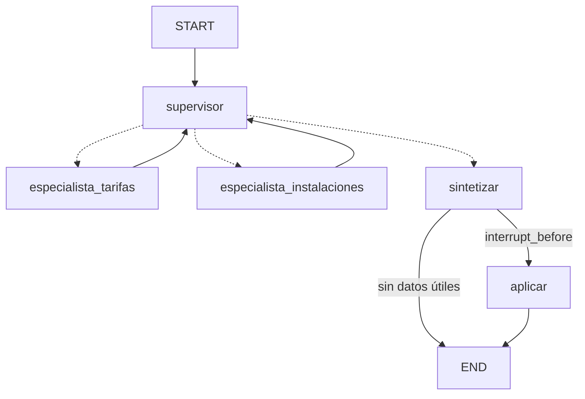

# Spec · Grafo del agente (SDD)

Cada requisito tiene un criterio de aceptación y el test que lo comprueba (`tests/test_grafo.py`).

## Nodos y edges

| Nodo | Qué hace | LLM | Fallback en Python |
|---|---|---|---|
| `supervisor` | Elige el siguiente nodo | Responde un nombre de la lista | Actividades/imagen → instalaciones; precios, abonos, normas o centros → tarifas; nada claro → tarifas; luego sintetizar |
| `especialista_tarifas` | Documentos oficiales | Elige tools de su lista ("Ninguna" se ignora) | `rag_ask` (+ `hora_actual` si dice "hoy", "ahora"…) |
| `especialista_instalaciones` | Agenda en vivo e imágenes | Elige tools de su lista | `api_deporte` (+ `describir_imagen` si hay imagen, + `hora_actual`) |
| `sintetizar` | Respuesta + plan en viñetas (solo pasos respaldados por las notas; la fuente va en la respuesta) | Redacta con `PLAN:` | Notas tal cual + plan mínimo. Si ninguna tool dio datos: respuesta directa sin plan ni HITL |
| `aplicar` | Guarda el plan en `salidas/` | No | — |

## Tools por especialista (allowlist)

| Especialista | `permitidas` |
|---|---|
| `especialista_tarifas` | `rag_ask`, `hora_actual` |
| `especialista_instalaciones` | `api_deporte`, `hora_actual`, `describir_imagen` |

El LLM solo elige **nombres** de tools; los argumentos los construye Python.
Cualquier otra tool queda `blocked` en la traza.
**Acepta si:** el LLM pide `api_deporte, borrar_todo` en tarifas → dos entradas `blocked` (`test_allowlist_bloquea_tools_ajenas_o_inventadas`).

## Límites (decididos en Python)

| Límite | Valor | Dónde | Test |
|---|---|---|---|
| `MAX_ITER` | 6 vueltas del supervisor por turno | `supervisor` | `test_max_iter_lo_decide_python` |
| `MAX_STEPS` | 3 tools por especialista | cada especialista | `test_max_steps_por_especialista` |
| `MAX_TURNS` | 10 turnos por `thread_id` | `procesar_turno` | — |

`done` lo pone `aplicar` y solo si el humano aprobó.

## Estado (`EstadoGrafo`)

`messages` se acumula entre turnos (memoria del `thread_id`); el resto se reinicia en cada turno:
`consulta`, `turnos`, `iter`, `siguiente`, `notas`, `log`, `traza_tools`, `respuesta`, `plan`, `aprobado`, `done`.

## Human-in-the-loop

- Compilado con `MemorySaver` + `interrupt_before=["aplicar"]`.
- `procesar_turno` corre hasta la pausa → `pendiente_hitl=True`.
- `aprobar_plan(thread_id, aprobado)` → `update_state({"aprobado": ...})` + `invoke(None)`.
- Aprobar → ficha en `salidas/`, `done=True`. Rechazar → sin efecto, `done=False`, se sigue en el mismo `thread_id`.
- Con un plan pendiente no se aceptan mensajes nuevos.

**Acepta si:** `test_pausa_antes_de_aplicar_y_aprobar`, `test_rechazar_no_aplica_y_se_puede_seguir_en_el_mismo_thread`, `test_no_acepta_mensaje_con_plan_pendiente`.

## Memoria

Una pregunta corta de seguimiento ("¿y para jubilados?") se completa con la pregunta anterior del mismo `thread_id`.
"Nueva conversación" = `thread_id` nuevo, sin memoria (`test_nueva_conversacion_empieza_sin_memoria`).

## Fallback del LLM

Sin clave, con error de Gemini (p. ej. 503) o con una respuesta inventada, el grafo funciona igual con las reglas de Python,
y el log indica el motivo: `fallback: error LLM: ...`, `fallback: respuesta no válida '...'`, `fallback: sin LLM`
(`test_fallback_si_el_llm_falla_y_el_log_dice_por_que`, `test_respuesta_inventada_del_supervisor_usa_fallback`).

## Sin datos útiles

Si ninguna tool devuelve `ok`, no se propone plan ni se pide aprobación: abstención → frase de abstención;
errores → mensaje claro sin el error crudo (que queda en la traza)
(`test_si_todas_las_tools_fallan_no_hay_plan_ni_hitl`, `test_abstencion_responde_sin_plan`).
